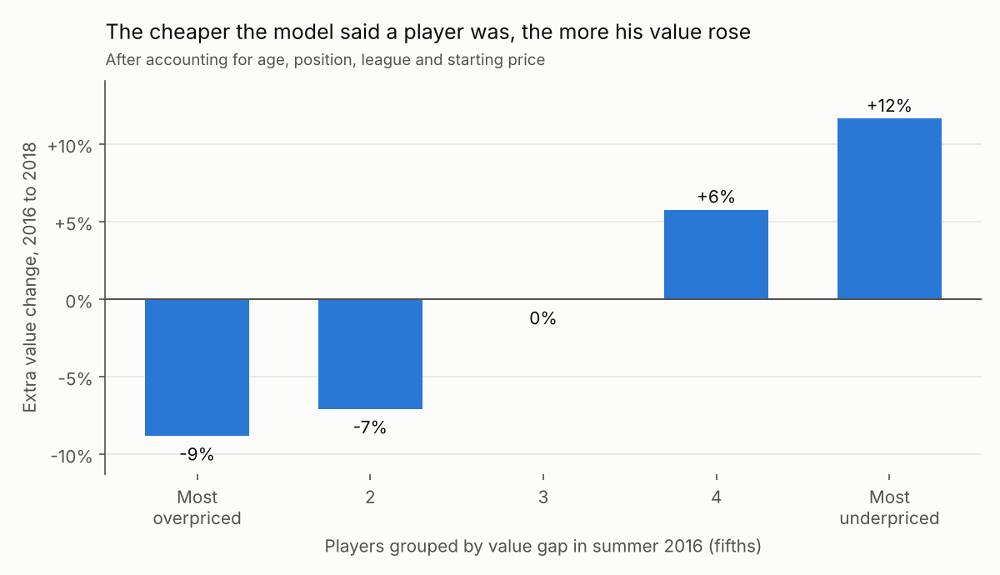
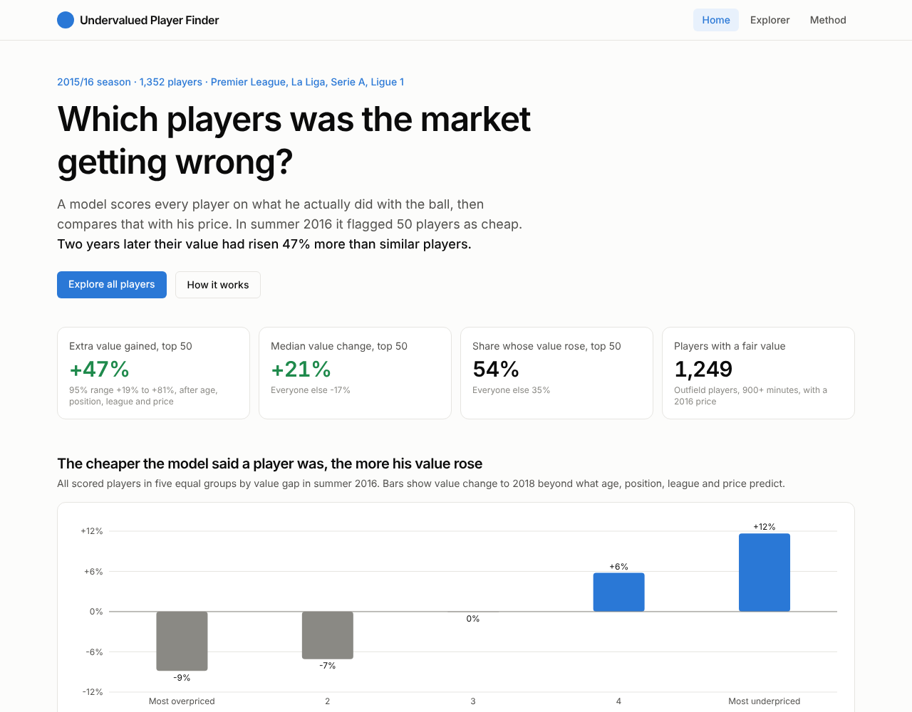

# Undervalued Player Finder

Finds soccer players whose on-ball contribution is worth more than their market value.

Built on StatsBomb open event data (2015/16 Premier League, La Liga, Serie A, Ligue 1, plus Leverkusen's Bundesliga matches) and Transfermarkt market values. It uses a custom expected goals (xG) model and an Expected Threat (xT) model, then checks its picks against what actually happened to those players' values in the next two years.

## Headline result

Players the model flagged as cheap in summer 2016 gained **47% more market value by 2018** than similar players (same age, position, league and starting price). 95% range +19% to +81%. Hits include Luis Alberto (EUR 4m to EUR 35m) and Cristiano Piccini (EUR 0.7m to EUR 7.5m). Details and limitations in `docs/findings.md`.



**Live site:** https://nainghtoochun.github.io/undervalued-player-finder/



## Run locally

```bash
python -m venv .venv
.venv\Scripts\activate                    # Windows
pip install -r requirements.txt
python -m pipeline.ingest_statsbomb         # all five leagues, 45 to 75 minutes
python -m pipeline.ingest_transfermarkt     # market values, a minute or two
python -m pipeline.run_all                  # xG, xT, player table, matching, value model, backtest
python -m pipeline.export_web               # JSON files for the website

# website (needs Node.js)
cd web && npm install && npm run dev        # http://localhost:5173

# database and API (needs Docker)
docker compose up -d
python -m pipeline.load_db
uvicorn api.main:app --reload               # http://localhost:8000/docs
```

## Structure

| Folder | What lives there |
| --- | --- |
| `pipeline/` | Data download, xG model, xT model, player metrics, value model, DB loading |
| `api/` | FastAPI backend on Postgres: `/players`, `/players/{id}`, `/bargains`, `/summary` |
| `web/` | React, TypeScript, Tailwind and Recharts site, published to GitHub Pages |
| `db/` | Postgres schema |
| `notebooks/` | Exploration only. Final logic always moves into `pipeline/` |
| `tests/` | 34 tests: models, metrics, matching, backtest, and the API against a real Postgres |
| `docs/` | Design decisions and the findings write-up |
